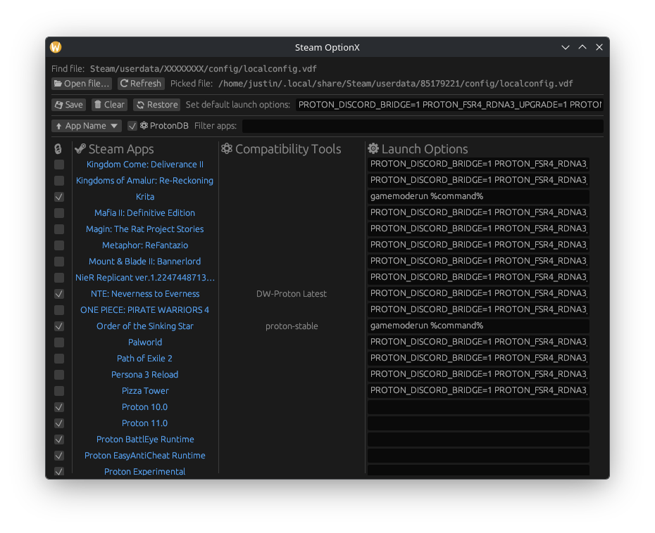

# Steam OptionX

An [egui](https://github.com/emilk/egui) application to modify app launch options in Steam's config file.

This application reads Steam's configuration files to determine app details.

Works on all platforms.



## Installation

### Linux

#### Nix

Install [NUR](https://github.com/nix-community/NUR) then install the package.

NixOS example:

```nix
# configuration.nix
environment.systemPackages = with pkgs; [
  nur.repos.rogreat.steam-optionx
];
```

## Build

Build and run from source NixOS example:

```nix
# home.nix
programs.devenv.enable = true;
```

```sh
cargo run --release
```

### Debug

`env_logger` provides debugging options:

```sh
RUST_LOG=steam_optionx=debug cargo run --release
```
